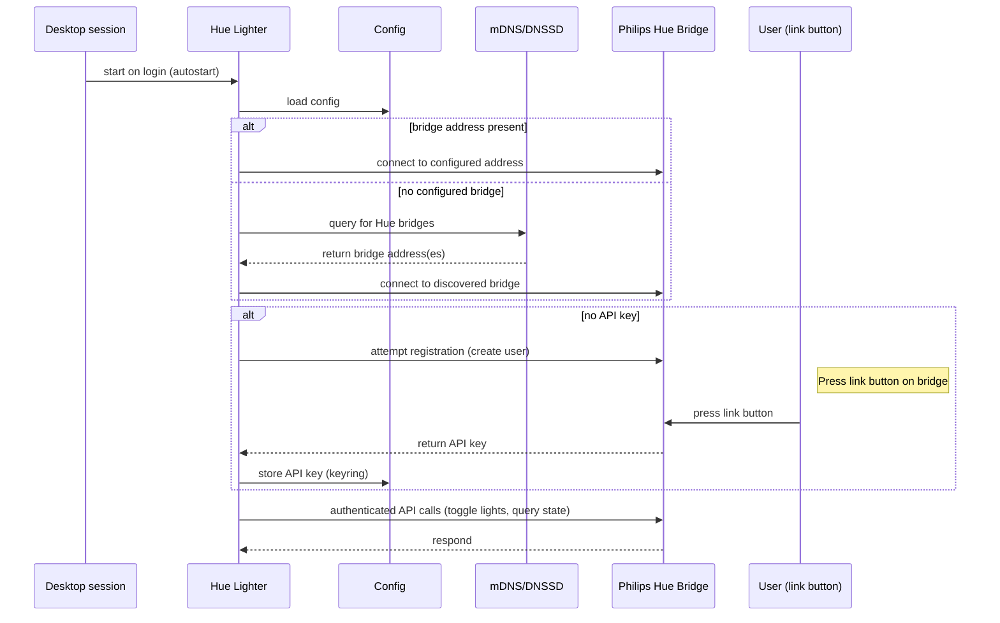

# Architecture

This document contains a compact container diagram for the running system and a sequence diagram describing bridge discovery.

## Container Diagram

```mermaid
flowchart TB
  subgraph LocalNetwork
    BRIDGE[Philips Hue Bridge]
  end

  subgraph Host [Desktop Session (Flatpak sandbox)]
    HUEL[Hue Lighter]
    TRAY[Tray Icon]
    CONFIG[Configuration]
    KEYRING[Keyring / Secret Service]
  end

  HUEL -->|reads| CONFIG
  HUEL -->|stores API key| KEYRING
  HUEL <-->|commands / light state events| TRAY
  HUEL -->|discovers & controls| BRIDGE

  classDef external fill:#f3f4f6,stroke:#bbb;
  class BRIDGE external
```

Notes:
- `Hue Lighter` runs in the user's desktop session (on Linux as Flatpak, started on login via the Background portal) and is responsible for discovery, registration, and automation. It stops and turns off the lights on `SIGTERM`, `SIGINT` or `SIGHUP` (logout, shutdown).
- The `Tray Icon` runs in its own goroutine; it sends a toggle command to the light automation and receives light state changed events, both via Go channels.
- `Configuration` defines which lights to manage; it lives in the XDG config directory (`~/.config/hue-lighter`, inside Flatpak `~/.var/app/io.github.yveskaufmann.HueLighter/config/hue-lighter`).
- The Philips Hue CA bundle, used to validate TLS when talking to the bridge, is embedded into the binary at build time (`HUE_CA_CERTS_PATH` overrides it).

## Bridge discovery — Sequence Diagram



Notes:
- Discovery uses mDNS/DNSSD to find local Philips Hue Bridges when no address is configured.
- Registration requires the physical link button on the bridge to be pressed; the app will prompt and retry as needed.
- Once registered, the app stores the API key and proceeds to control configured lights.

